# Vinyl ADC

[Assembly guide & bench log](https://vinyl-adc.madsrudolph.dev/) · [Rev D bring-up, 20 October](docs/bringup-log-2026-10-rev-d.md) · [Bring-up log, 16–18 September](docs/bringup-log-2026-09.md) · [16 September bench plan](assembly/sessions/2026-09-16/README.md) · [6 September test handoff](assembly/sessions/2026-09-06/README.md)

**Rev D (20 October): built, made by PCBWay, and running.** The converter now lives on one four-layer Raspberry Pi HAT, [fabricated by PCBWay](#rev-d-the-pcbway-board), in place of the four hand-milled boards it was born on. Both channels modulated correctly from the first capture, and with the turntable connected the whole chain records about **8 dB more A-weighted range** than the milled stack did, on the Pi's own 5 V. On the bench, on its own crystal, the left channel measures **78.7 dB dynamic range**, 11 dB past the milled stack's best. Record: [rev D bring-up log](docs/bringup-log-2026-10-rev-d.md).

**The milled stack (September):** all four boards are assembled and bench-screened with the AD3 (16–17 September): power, rev B digital with the on-board crystal Pierce, both channels and the full stack pass, after resoldering a crystal leg and swapping the reference op-amp U2 to an LM358 for output headroom on the charge-pump rail (design-notes §10b′). A Raspberry Pi 4 captures the stream, and a ripper service on it records sides automatically, splits and tags the tracks and hands finished albums to the Jellyfin server; setup in [pi/README.md](pi/README.md) and [server/README.md](server/README.md). No complete-system audio performance is claimed by these assembly tests.

**Rev C (22 September):** with a fab available, the four milled boards are redrawn as [one 4-layer board](hardware/kicad/rev_c/README.md), 170 × 120 mm, all through-hole, with the Raspberry Pi 4 plugged into its underside on its own 40-pin header and the bench fixes (LM358 reference, filtered 5 V inlet, series resistors on the I2S clocks) built in. It passes the same intent gate as the milled boards against the reference sheet; [production files](production/vinyl_adc_rev_c/) and a [bill of materials](docs/bom-rev-c.md) are exported. It was never built: rev D superseded it.

**Rev D (designed 22–25 September):** with PCBWay sponsoring the fabrication, the one-board converter is redrawn as a proper [Raspberry Pi HAT](hardware/kicad/rev_d/README.md) — 140 × 136 mm (its layout redone on 24 September: every passive beside the pin it serves, channel R a copy of channel L), four layers, still every part through-hole from the DTU shop — and given the things the bench asked for: an analog supply island behind its own choke (the DAC reference rail, kept away from the Pi's and the charge pump's switching), a second 74HC244 to stiffen the −5 V pump, a damped MCLK, eight front-edge status LEDs (rail, pump, clock-alive, clip L/R from LM339 window comparators, and three under the Pi's control), shutdown and user buttons, a HAT ID EEPROM, test-point headers with ground pins, and a tonearm ground terminal with a lift network. `tools/check_rev_d.py` proves it is the reference circuit plus exactly those additions; [production files](production/vinyl_adc_rev_d/) and the [bill of materials](docs/bom-rev-d.md) are exported. Design record: [design-notes §12](docs/design-notes.md#12-rev-d-the-converter-as-a-raspberry-pi-hat-22-september-2026).

**Rev E (24 September):** the same circuit in common [surface-mount parts](hardware/kicad/rev_e/README.md) on a 118 × 88 mm four-layer HAT — 0805 C0G/X7R and thin-film parts, SOIC logic and op-amps, SOT-23 transistors, shielded SMD chokes — checked by the same gate as rev D, placed and routed by the same tools, DRC clean. [Production files](production/vinyl_adc_rev_e/) include the pick-and-place file for PCBWay assembly; [bill of materials](docs/bom-rev-e.md); design record [design-notes §13](docs/design-notes.md).

<p align="center">
  <a href="https://madsrudolph.github.io/vinyl-adc/"></a>
  <a href="https://github.com/MadsRudolph/srm-cam"></a>
  
  
  
  
</p>

<p align="center">
  <strong>A Discrete 3rd-Order Continuous-Time Delta-Sigma Stereo Audio ADC</strong><br>
  Engineered from standard analog op-amps &amp; 74HC CMOS logic — <em>zero dedicated ADC ICs anywhere in the signal chain</em>.<br>
  All circuit boards isolation-milled on a <strong>Roland SRM-20</strong> CNC mill using <a href="https://github.com/MadsRudolph/srm-cam"><strong>SRM-CAM</strong></a>.
</p>

<p align="center">
  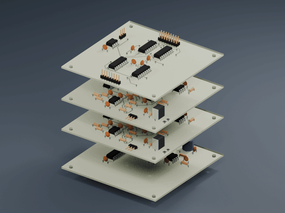
</p>

<p align="center">
  <a href="media/showcase/README.md">Download GIF animations &amp; print files</a>
</p>

<details>
<summary><strong>More views: the enclosure orbit and exploded assembly</strong></summary>

### Product orbit

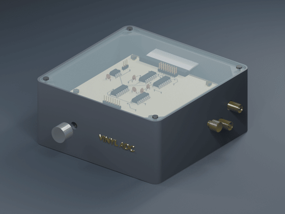

### Exploded assembly

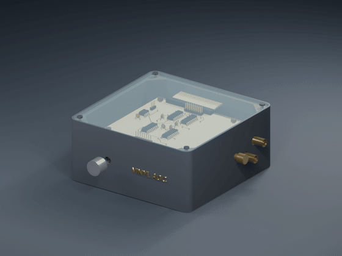

</details>

<p align="center">
  👉 <strong><a href="https://madsrudolph.github.io/vinyl-adc/">Launch Live Interactive 3D Web Viewer &amp; Explosion Slider</a></strong> 👈
</p>

---

## Rev D: the PCBWay board

<p align="center">
  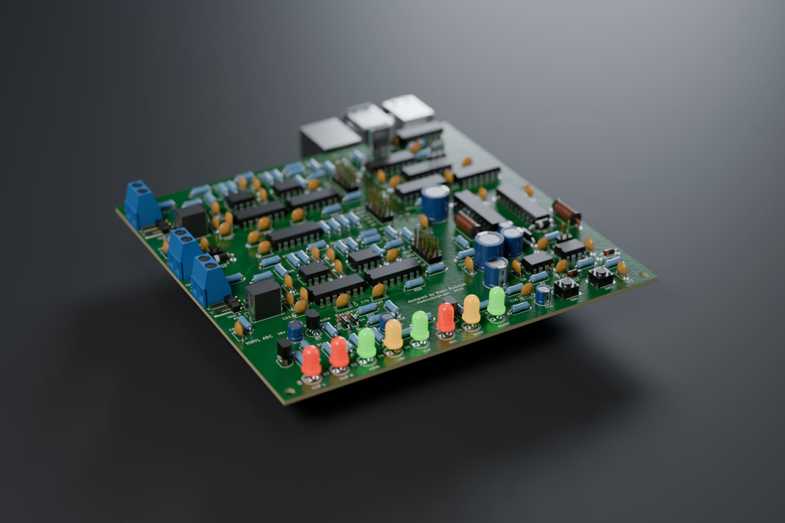
</p>

**One board, four layers, made by [PCBWay](https://www.pcbway.com), and the best-measuring version of this converter so far.**

Every Vinyl ADC board before rev D was isolation-milled, single-sided, at the university workshop. When **PCBWay offered to sponsor the fabrication**, the converter could finally be drawn the way a mixed-signal circuit wants to be: one board, a solid ground plane, plated holes everywhere, and the Raspberry Pi plugged in underneath. Thank you to PCBWay for making that possible; this section is about what their boards did for the project.

<p align="center">
  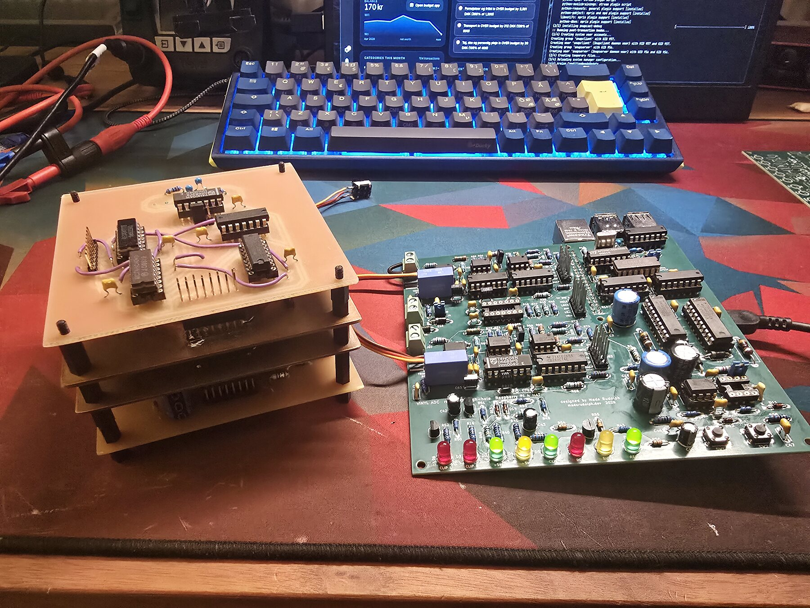<br>
  <sub>Before and after: the four-board milled stack, and rev D as PCBWay made it.</sub>
</p>

<p align="center">
  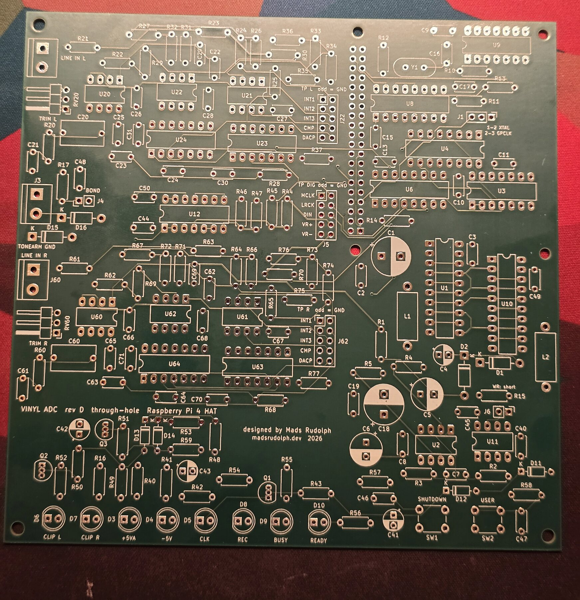
  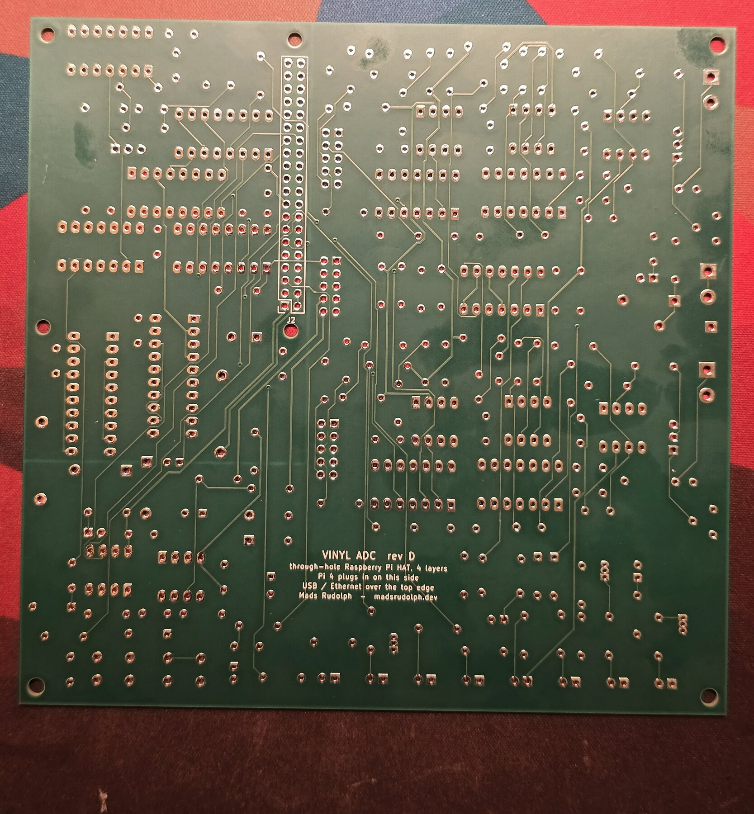<br>
  <sub>The bare board as it arrived, both sides.</sub>
</p>

### What PCBWay made

| | Rev D, per board |
|---|---|
| Stack-up | **4 layers**: signals / solid GND plane / split +5V·+5VA / signals, 1.6 mm FR-4, 1 oz copper |
| Finish | green solder mask on both sides, white silkscreen, HASL lead-free |
| Holes | **636 plated through-holes and 13 vias**: 649 plated barrels on every board, five boards |
| Routing | 1,020 tracks, the narrowest 0.25 mm; drills from 0.4 mm to 2.7 mm |
| Legends | 184 reference designators at 1 mm text height, the smallest labels 0.8 mm |
| Parts | 184, every one through-hole, socketed ICs |
| Size | 140 × 136 mm, a Raspberry Pi 4 HAT |

<p align="center">
  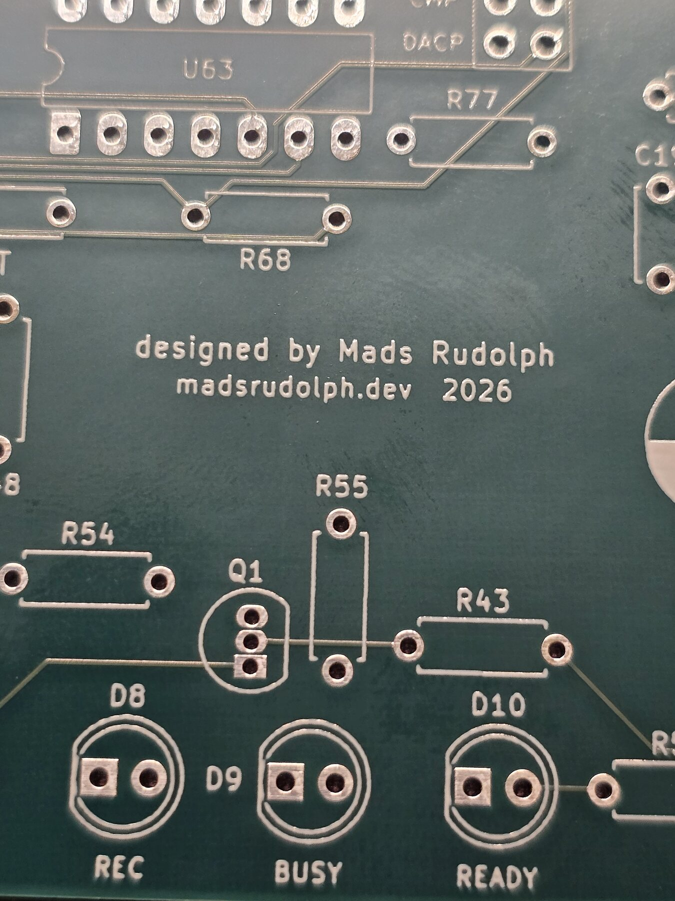
  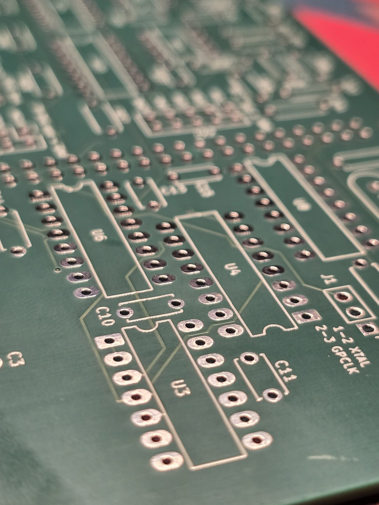<br>
  <sub>Up close: legends under a millimetre tall come out clean, and every barrel is plated and tinned.</sub>
</p>

### Why a fab board, for a converter

- **A real ground plane.** A delta-sigma modulator switches at 1.536 MHz next to integrators that resolve microvolts. On one milled layer, ground was whatever copper was left between tracks. On rev D an entire inner layer is ground, directly under every signal, and a large part of the improvement measured below is owed to it.
- **Plated holes.** Every joint is soldered from one side and the barrel carries it through. The single most expensive fault of the September bring-up, a −5 V rail that reached one board only through solder wicked up an unplated hole, cannot exist on this board.
- **Repeatability.** Five identical boards. The milled boards were each a one-off; a second rev D is the same board as the first.

### Milled against fabricated

| | Milled stack (Sept 2026) | Rev D by PCBWay (Oct 2026) |
|---|---|---|
| Boards | 4 × 100 × 100 mm, stacked on a bus | **1 × 140 × 136 mm** Raspberry Pi HAT |
| Copper | 1 layer, milled, bare copper | **4 layers** with a solid ground plane |
| Links | dozens of wire jumpers | **none**: plated through-holes and vias |
| Finish | none | solder mask both sides, silkscreen, HASL lead-free |
| Supply for best figures | bench supply (the Pi's 5 V cost 6–11 dB) | **the Pi's 5 V**, analog island behind its own choke |
| Bring-up | two days, two hidden faults in one channel | **both channels healthy and matched at the first capture** |

**Measured, with the turntable connected** (stylus up, same phono stage, same method, music peaks set to −6 dBFS on both builds):

| 20 Hz–20 kHz | Milled stack, bench supply, crystal clock | **Rev D, Pi 5 V, Pi clock** (crystal not yet running) |
|---|---|---|
| Idle floor, A-weighted | −61.1 / −62.1 dBFS | **−69.7 / −68.2 dBFS** |
| Idle floor, 200 Hz–2 kHz | −68.6 / −69.4 dBFS | **−73.7 / −73.6 dBFS** |
| Idle floor, 2–20 kHz | −59.6 / −60.6 dBFS | **−76.5 / −70.5 dBFS** |
| Music peak to floor, A-weighted | 54.2 / 55.2 dB | **63.7 / 62.2 dB** |
| Music peak to floor, unweighted | 48.9 / 49.2 dB | **51.4 / 51.3 dB** |

### What that adds up to

About **8 dB more A-weighted range** from the groove to the file, and a noise floor 5–17 dB lower everywhere above 200 Hz, measured on the Raspberry Pi's 5 V (the supply that cost the milled stack the most) and, at the time, on the Pi's own clock. What remains in the unweighted figure is 50 Hz hum common to both channels: the turntable's grounding, not the converter.

**On the bench, with its own crystal** (AD3 generator into the input, other input shorted, Pi supply):

| | Milled stack, best channel | **Rev D, left** | Rev D, right |
|---|---|---|---|
| Dynamic range (AES17, A-weighted) | 67.9 dB | **78.7 dB** | 72.2 dB |
| THD at −6 dBFS | 0.03 % | **0.019 %** | 0.052 % |
| Crosstalk | −92.4 dB | **−97.8 dB** | −85.8 dB |
| Response 20 Hz–16 kHz | ±0.06 dB | −0.30 / +0.08 dB | −0.33 / +0.08 dB |

The left channel is **about 11 dB better than anything the milled boards achieved**, and 10 dB past the ~68 dB the design was simulated for. The right channel carries an extra in-band floor that the milled stack's right channel had too; it is traced to the right modulator's own loop and still being chased ([bring-up log §10](docs/bringup-log-2026-10-rev-d.md#10-the-right-channels-deficit-is-in-its-loop-and-it-is-not-new)).

Bring-up said as much as the measurements. The milled stack took two days and two faults that hid each other before its right channel modulated. On rev D both channels were healthy, and matched, on the first capture. The one rev D fault found so far is my own design error, not the fab's: the clip-LED comparators' inputs are swapped in the schematic, documented as an [erratum](docs/bringup-log-2026-10-rev-d.md#7-erratum-the-clip-leds-are-lit-all-the-time) with a rework that stays on the underside.

<p align="center">
  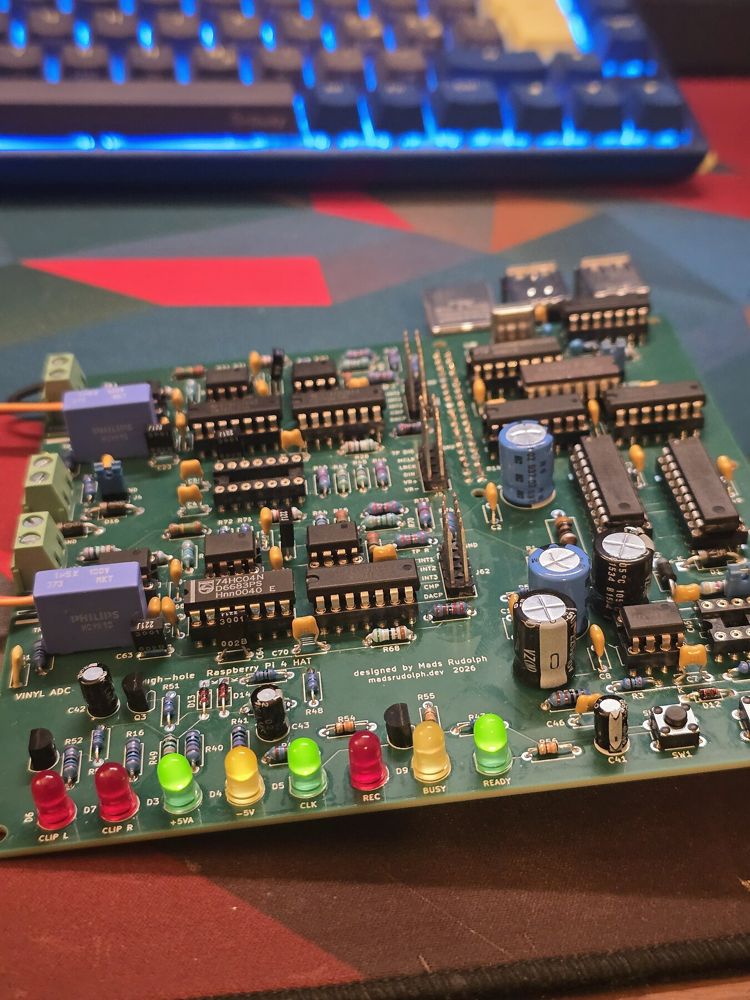<br>
  <sub>Assembled and running on its Raspberry Pi 4.</sub>
</p>

<p align="center">
  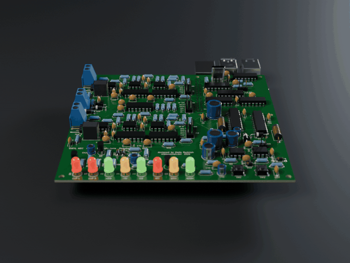<br>
  <sub>CAD renders (<a href="media/showcase/rev-d/README.md">all views and how they are made</a>); Raspberry Pi 4 model from the FreeCAD parts library, CC BY 3.0.</sub>
</p>

The [Gerbers and production files](production/vinyl_adc_rev_d/), the [KiCad project](hardware/kicad/rev_d/README.md) and the [full rev D bring-up log](docs/bringup-log-2026-10-rev-d.md) are all in this repo. Boards sponsored by **[PCBWay](https://www.pcbway.com)**: thank you for making the project's best version possible.

---

## Audiophile Engineering Specifications

| Specification | Target / Measured Performance | Design Rationale & Implementation |
|---|---|---|
| **Modulator Topology** | Continuous-Time CIFB (Cascade of Integrators, Feedback) | 3rd-order active RC loop with local resonator feedback (`G = 0.03`) |
| **Dynamic Range / SNR** | **68.3 dB measured in 20 kHz band** | Purposefully matched to the physical vinyl surface noise floor (~60–65 dB) |
| **Audio Output** | **24-bit / 48 kHz Linear PCM FLAC** | Decimated in software on Raspberry Pi CPU (CIC filter + compensation FIR) |
| **Modulator Sampling Rate ($F_s$)** | **1.536 MHz** ($32\times$ OverSampling Ratio) | Matches bandwidth constraints of DTU-stocked op-amps (`TL072` 3 MHz GBW) |
| **Master Clock ($F_{clk}$)** | **6.144 MHz crystal Pierce oscillator** (74HCU04 + HC-49 crystal) | Direct low-jitter clock ($<50\text{ ps}$ jitter vs. Pi PLL phase noise); also available as a plug-in module for the rev A board |
| **Digital Stream Format** | Bit-Interleaved PDM on standard I2S bus | 3.072 Mbps data stream, read as 32-bit stereo audio frames at 48 kHz |
| **Analog Inputs** | Gold RCA Phono Jacks &amp; 5.08 mm Screw Terminals | Switchable input gain via front-panel multi-turn trim potentiometer |
| **Analog Grounding** | Star-ground topology with tonearm binding post | Eliminates 50 Hz turntable motor hum and ground-loop switching transients |
| **PCB Manufacturing** | Rev D: 4-layer 1.6 mm FR-4, HASL lead-free, by **[PCBWay](https://www.pcbway.com)**. First build: isolation-milled single-sided FR4 | Milled toolpaths generated via [**SRM-CAM**](https://github.com/MadsRudolph/srm-cam) on a **Roland SRM-20** mill |
| **Enclosure Dimensions** | $144.0\text{ mm} \times 144.0\text{ mm} \times 105.0\text{ mm}$ | Open organic lattice, reinforced connector islands and M3 lid inserts; recessed $3.0\text{ mm}$ acrylic lid |

---

## Printable enclosure

The enclosure has an open, rounded lattice on all four sides and 40 mm more height for the PCB stack and cable routing. Solid connector islands and reinforced lid-insert bosses carry the mounting loads. **Print upright with supports**; the revised mesh and supported slice pass validation, but physical print/fit testing is still pending.

[STL, 3MF, insert-fit coupon and printing instructions](enclosure/README.md) · [Three looping GIFs](media/showcase/README.md)

## Signal Processing Flow

```
   ┌─────────────────────────────────────────────────────────────────────────────┐
   │                          ANALOG SIGNAL CHAIN (HARDWARE)                     │
   │                                                                             │
   │  Turntable (Debut Carbon)                                                  │
   │         │                                                                   │
   │         ▼                                                                   │
   │  Phono Preamplifier                                                         │
   │         │                                                                   │
   │         ▼                                                                   │
   │  [ VINYL ADC ] ──> 3rd-Order CT-ΔΣ ──> 1.536 MHz PDM ──> 74HC157 Mux       │
   │   Gold RCA In      TL072 + LM311       74HC74 Retimed    Stereo Interleave  │
   └─────────────────────────────────────────────────────────────────┬───────────┘
                                                                     │ 3.072 Mbps
                                                                     ▼
   ┌─────────────────────────────────────────────────────────────────────────────┐
   │                         DIGITAL DSP CHAIN (RASPBERRY PI)                    │
   │                                                                             │
   │  ALSA I2S Interface (48 kHz / 32-bit Frame Capture)                         │
   │         │                                                                   │
   │         ▼                                                                   │
   │  Software De-interleaver (Separates Left & Right Bitstreams)                │
   │         │                                                                   │
   │         ▼                                                                   │
   │  4th-Order CIC Decimator (Downsamples 32x to 48 kHz Nyquist)                │
   │         │                                                                   │
   │         ▼                                                                   │
   │  FIR Droop & Phase Compensation Filter                                      │
   │         │                                                                   │
   │         ▼                                                                   │
   │  24-bit / 48 kHz Bit-Perfect FLAC Encoder ──> Jellyfin Media Server         │
   └─────────────────────────────────────────────────────────────────────────────┘
```

---

## Noise-Shaping & SPICE Verification

The defining characteristic of delta-sigma conversion is **noise shaping**: pushing quantization noise out of the audible spectrum into ultrasonic frequencies where digital decimation filters remove it completely.

<p align="center">
  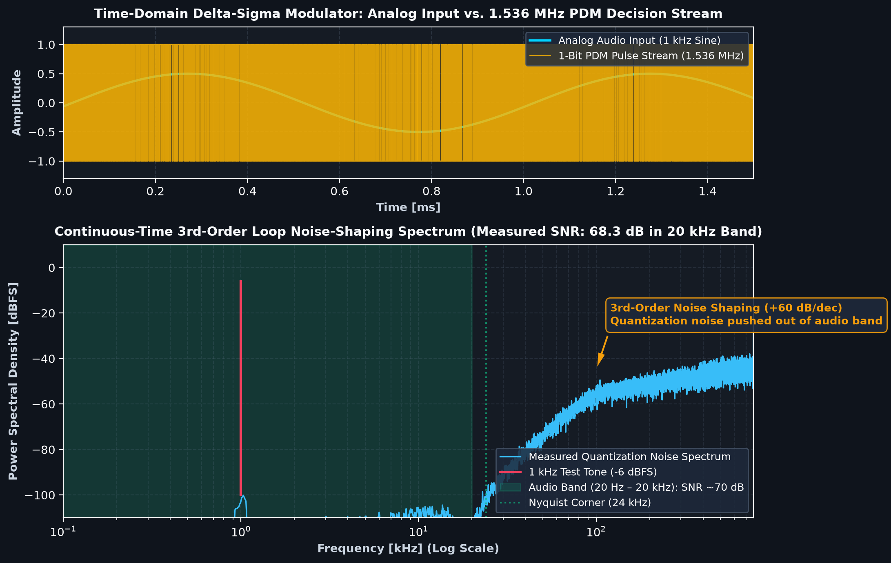
</p>

- **Time-Domain (Top):** Shows the incoming 1 kHz analog test sine wave alongside the discrete 1.536 MHz 1-bit decision stream. The pulse density cleanly mirrors the instantaneous input amplitude.
- **Frequency-Domain (Bottom):** Measured FFT spectrum with Hann windowing. The audible passband (20 Hz – 20 kHz, shaded green) exhibits a **68.3 dB SNR** with clean third-order $+60\text{ dB/decade}$ noise shaping that drives quantization noise above 30 kHz.

---

## The original 4-board milled stack (rev A/B)

To overcome the routing limitations of single-layer CNC isolation milling (0.84 mm clearance between DIP pins), the system is split into four 100 × 100 mm boards interconnected by a 16-pin ribbon bus and M3 brass standoffs:

| Tier & Board | 3D Raytraced Board Render | Function & Key Components |
|---|:---:|---|
| **Tier 4 (Top)**<br>[`vinyl_adc_digital`](hardware/kicad/digital/) | 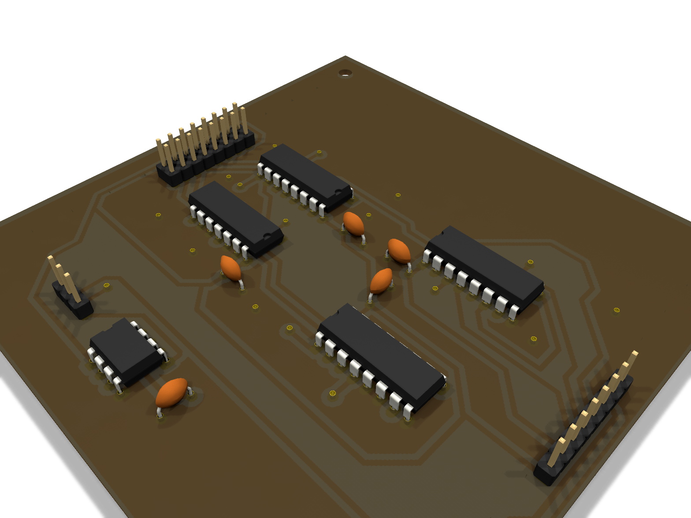 | **Clock, Interleaving & Pi Interface:**<br>• 6.144 MHz crystal Pierce oscillator (`Y1` + `74HCU04`)<br>• `74HCT132` Schmitt-trigger clock buffer<br>• `74HC4040` binary clock divider ($F_s = 1.536\text{ MHz}$, $\text{BCLK} = 3.072\text{ MHz}$, $\text{LRCLK} = 48\text{ kHz}$)<br>• `74HC157` stereo bit-interleaving MUX<br>• `74HC4049` 5 V $\rightarrow$ 3.3 V level shifter to Raspberry Pi |
| **Tier 3**<br>[`vinyl_adc_channel_l`](hardware/kicad/channel_l/) | 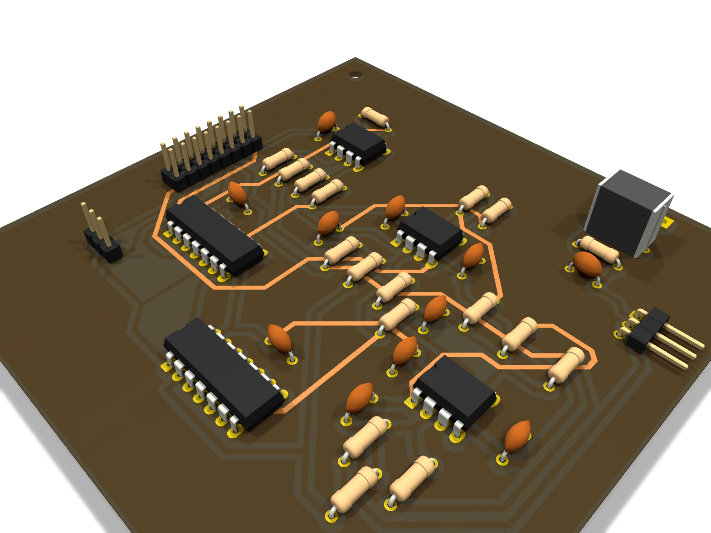 | **Left Channel Modulator:**<br>• 3rd-order active RC integrators (`TL072`)<br>• `LM311` high-speed comparator<br>• `74HC74` retiming flip-flop &amp; 1-bit DAC network<br>• Multi-turn input gain trim potentiometer<br>• Jumper set to Left (`pins 1-2`) |
| **Tier 2**<br>[`vinyl_adc_channel_r`](hardware/kicad/channel_r/) |  | **Right Channel Modulator:**<br>• Identical artwork to Tier 3 (milled twice)<br>• Jumper set to Right (`pins 2-3`)<br>• Independent ground plane &amp; analog reference |
| **Tier 1 (Base)**<br>[`vinyl_adc_power`](hardware/kicad/power/) | 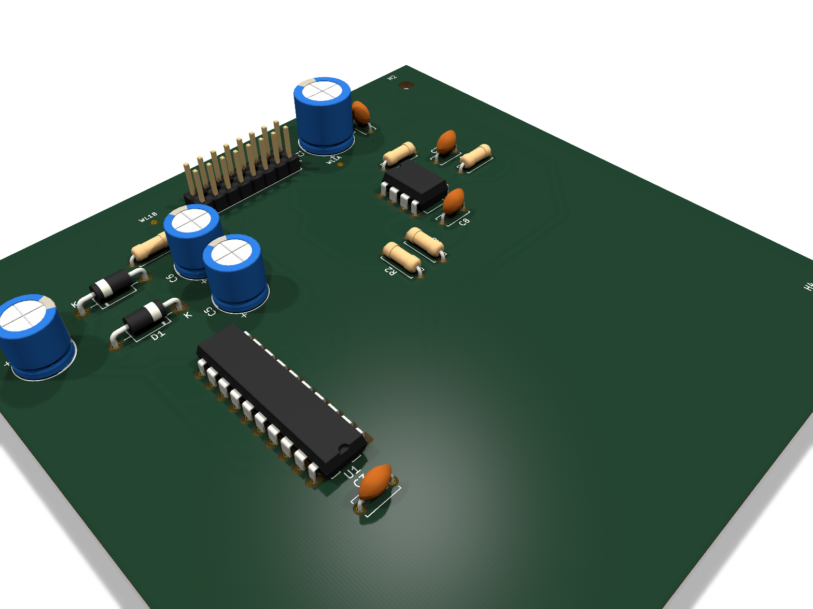 | **Power & Reference Generation:**<br>• `74HC244` + `1N5817` charge-pump negative rail<br>• Low-noise precision virtual ground reference (`TL072`)<br>• High-capacity bulk reservoir &amp; post-filter network<br>• 4× M3 mounting holes seated onto enclosure floor bosses |

---

## PCB Fabrication with SRM-CAM & Roland SRM-20

The four boards of the first build were designed for single-sided isolation milling on the **Roland SRM-20** desktop CNC mill at the DTU FabLab. That constraint is why the converter was split into four boards with dozens of wire links; [rev D](#rev-d-the-pcbway-board) is the same circuit on a fabricated four-layer board.

<p align="center">
  <a href="https://github.com/MadsRudolph/srm-cam"></a>
</p>

The RML-1 milling toolpaths and G-code were generated directly using [**SRM-CAM**](https://github.com/MadsRudolph/srm-cam) (`gerber2rml`):
- **Isolation Routing:** Traces isolation-milled on `B.Cu` using 0.2 mm / 0.4 mm V-bits with wide rubout for ground separation.
- **Excellon Drilling:** Automatic hole-center extraction from KiCad `*.drl` files for all DIP sockets, film caps, resistors, and headers.
- **Edge Routing:** Clean board profiling with 1.0 mm end mill for the 100 × 100 mm PCB footprint and M3 mounting holes.
- **Workpiece Fixturing:** Copper-clad FR4 secured using the double-sided tape &amp; CA glue method documented in the [SRM-CAM User Guide: Holding the copper](https://madsrudolph.github.io/srm-cam/holding-the-copper.html).

All production Gerbers and Excellon drill files ready for SRM-CAM are located in [`production/`](production/).

---

## Raspberry Pi Wiring & Star-Grounding Architecture

Turntable systems are exceptionally sensitive to 50/60 Hz hum and digital switching noise. The Vinyl ADC implements an isolated star-grounding architecture:

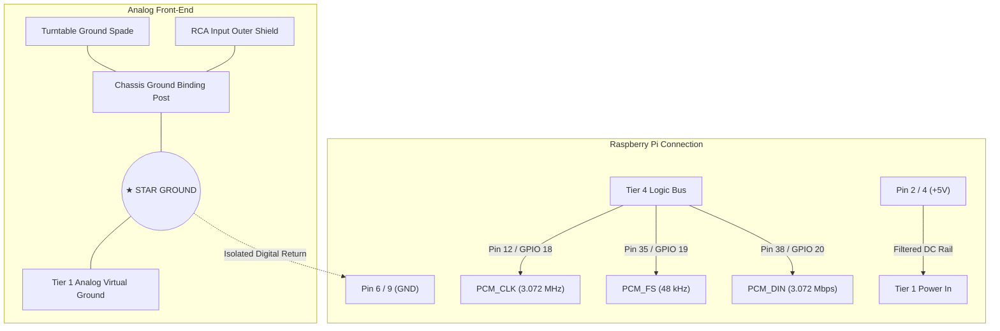

### Raspberry Pi 40-Pin GPIO Pinout:

This is the milled stack's wiring. Rev D plugs onto the Pi as a HAT and also uses GPIO3/4/17/22/23/27 and the ID EEPROM pins: see [pi/README.md §7](pi/README.md#7-rev-d-hat-what-the-board-puts-on-the-gpio-header).

| Raspberry Pi Pin | Signal Name | Vinyl ADC Connection | Function |
|---|---|---|---|
| **Pin 2 or 4** | `+5V Power` | Tier 1 DC Input | Supplies digital and analog converter power |
| **Pin 6 or 9** | `GND` | Tier 4 Logic Ground | Digital switching current return |
| **Pin 12 (GPIO 18)** | `PCM_CLK` | Tier 4 Clock Out | 3.072 MHz bit clock for I2S capture |
| **Pin 35 (GPIO 19)** | `PCM_FS` | Tier 4 Frame Sync | 48 kHz word clock (L/R frame framing) |
| **Pin 38 (GPIO 20)** | `PCM_DIN` | Tier 4 Interleaved PDM | Serial stream carrying alternating Left/Right bits |

---

## Repository Structure

```
├── docs/                           # Documentation & Interactive Web App
│   ├── index.html                 # Interactive 3D Web Viewer for GitHub Pages
│   ├── vinyl_adc_assembled.glb    # Complete 3D CAD model with explosion timeline
│   ├── shopping-list.md           # Component shop procurement list
│   ├── bom.md                     # Bill of materials
│   └── design-notes.md            # Circuit design decisions and SPICE findings
├── enclosure/                      # 3D print and laser cutting files
│   ├── vinyl_adc_enclosure.blend  # Complete Blender 3D CAD scene
│   ├── vinyl_adc_enclosure_base.3mf # Millimetre print mesh
│   ├── vinyl_adc_enclosure_base.stl # Watertight binary STL
│   ├── vinyl_adc_plexiglass_top.svg # 1:1 Spirit laser cutter SVG
│   ├── vinyl_adc_plexiglass_top.dxf # 1:1 AutoCAD R12 DXF
│   └── *.glb                      # 3D board exports from KiCad
├── hardware/kicad/                 # KiCad 10 schematics, boards & routing
│   ├── power/                     # Tier 1: Power & voltage reference board
│   ├── channel_l/                 # Tier 2 & 3: Modulator channel (milled twice)
│   ├── digital/                   # Tier 4: Digital clock & Pi interface
│   ├── sim/                       # 8x SPICE testbenches for loop validation
│   └── tools/                     # Python layout and netlist verification scripts
├── production/                     # Production-ready Gerbers and Excellon drill files for SRM-CAM
├── media/                          # Visuals, renders, and animations
│   ├── vinyl_adc_assembly.gif     # Looping 3D exploded view animation
│   ├── vinyl_adc_assembly.mp4     # 720p 24fps H.264 animation video
│   ├── noise_shaping_spectrum.png # Continuous-time 3rd-order FFT plot
│   ├── laser_engraved_lid.png     # Clear acrylic lid technical artwork
│   └── pcb_renders/               # Raytraced KiCad 3D renders of each PCB tier
└── sim/                            # Modulator numerical simulation models
```

---

## Interactive 3D Web Viewer

Test the 3D model and scrub the exploded assembly timeline directly in your browser:  
🔗 **[https://madsrudolph.github.io/vinyl-adc/](https://madsrudolph.github.io/vinyl-adc/)**

---

## Related Projects

- [**SRM-CAM (`gerber2rml`)**](https://github.com/MadsRudolph/srm-cam): Desktop CAM for the Roland SRM-20 CNC mill used to isolation-mill the PCBs for this project.

---

## License

MIT License — free for personal and educational use.
