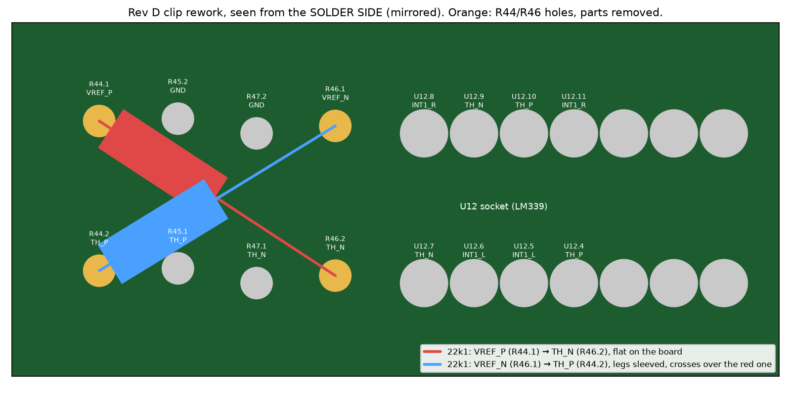

# Vinyl ADC rev D: bring-up log, 20 October 2026

Rev D is the converter redrawn as one four-layer Raspberry Pi HAT and made by
PCBWay, who sponsored the boards. It replaces the four isolation-milled,
single-sided boards that were brought up in September
([bring-up log, 16–18 September](bringup-log-2026-09.md)); those boards and
their measurements are the baseline every figure here is compared with. Design
record: [design-notes §12](design-notes.md), board files:
[`hardware/kicad/rev_d/`](../hardware/kicad/rev_d/README.md).

## 1. The board

| | Milled stack (rev A/B, Sept 2026) | Rev D (PCBWay, Oct 2026) |
|---|---|---|
| Boards | 4 (power, channel L, channel R, digital), stacked on a bus | 1 |
| Layers | 1, isolation-milled on a Roland SRM-20 | 4: signal / solid GND / split +5V·+5VA / signal |
| Size | four × 100 × 100 mm | 140 × 136 mm, Pi 4 underneath as a HAT |
| Links | dozens of wire jumpers, component-side joints no iron reaches | none: plated through-holes and vias |
| Material, finish | FR-4 copper-clad, bare copper | 1.6 mm FR-4, 1 oz copper, HASL lead-free, solder mask both sides, silkscreen |
| Pi connection | flying leads to the header | 2×20 socket on the copper side |
| Power | bench supply for the best figures; the Pi's 5 V cost 6–11 dB | the Pi's 5 V, with an analog island (+5VA) behind its own choke |

Five boards were ordered on 25 September; one is assembled. Every part is
through-hole and socketed, as on the milled boards.

## 2. The Pi side

Capture needed no change: rev D uses the same I²S pins (GPIO18/19/20) with the
Pi as clock consumer, so the overlay, the consumer-mode service and the ripper
ran as they were. What rev D adds on the header is new software:

- **`pi/panel.py`**, started by the ripper: REC (GPIO17) while a side records,
  BUSY (GPIO27) while identifying, cutting or encoding, READY (GPIO22) when idle
  with the card open, blinking while the ADC sends no clocks. SW2 (GPIO23) is
  the dashboard's Record / Stop on a button, for what the needle detector cannot
  judge: a very quiet lead-in, or a side to end now rather than after 60 s of
  silence. It is ignored while there are no clocks, so a press cannot start a
  side the moment the clocks appear.
- **SW1** is the power button: `dtoverlay=gpio-shutdown` in `config.txt`, and
  GPIO3 wakes a halted Pi by itself.
- **`pi/gpclk.py`** starts the Pi's GPCLK0 on GPIO4 (§3).

## 3. First power-up: no clocks from the crystal

The Pi booted, the I²S pins went to consumer mode, and no undervoltage was
flagged, but the ripper reported no clocks. Sampled 200 times each, PI_BCLK sat
high, PI_LRCLK and PI_DIN low: nothing toggled. The fault was on the board's
master clock (the 6.144 MHz crystal oscillator), upstream of the divider chain.
It is not yet diagnosed.

The board was designed for this: J1 (CLK SEL) can feed the clock buffer from the
Pi's GPCLK0 instead, a fallback that had never been needed. `pi/gpclk.py`
programs GPCLK0 from PLLD (750 MHz ÷ 122.0703 = 6.144000 MHz, MASH 1) and puts
GPIO4 on ALT0. With J1 moved, all three I²S lines toggled and the ripper went
straight to idle in stereo.

**Every figure below was taken on the Pi's clock.** GPCLK0's fractional divider
carries about 1 ns of jitter, which design-notes §5 puts at a ~68 dB ceiling for
the converter; the crystal is specified below 50 ps. They are therefore a
conservative view of rev D, not its final numbers.

## 4. Both channels, first time

| At the bitstream, no music | Milled stack (Sept) | Rev D, left | Rev D, right |
|---|---|---|---|
| Verdict | third-order shaping | Healthy | Healthy |
| One-density | 0.4957 | 0.4983 | 0.4960 |
| Mean run of identical bits | 1.35 / 1.36 | 1.40 | 1.37 |
| Noise shaping, 30→80 kHz | +68.1 / +68.6 dB/dec | +66 dB/dec | +68 dB/dec |

The milled stack took two days and two hidden faults before its right channel
modulated (the −5 V supply reaching the board only through solder wicked up an
unplated hole, then a short on the feedback DAC). Rev D's two channels were
healthy, and matched, from the first capture.

The first look showed the left channel 14 dB noisier than the right. Its input
trimmer RV20 was simply at the end of its travel; once set with a record
playing (`pi/levels.py`), both channels peak at **−6.0 dBFS** (95th percentile
of the 100 ms peaks over 45 s, the September method; September's setting was
−6.9 dBFS) with 17 dB crest factor and no sign of clamping.

## 5. Milled against fabricated: the idle floor with the turntable connected

The same measurement as [test-and-verification §5b](test-and-verification.md):
stylus up, platter stopped, the whole chain powered (turntable → Pro-Ject phono
stage → converter), trimmers set for music peaks near −6 dBFS, ten seconds of the
ripper's own 48 kHz output. The turntable's ground wire goes to the phono stage
only, as in September; rev D's J3 tonearm terminal is unused (J4 fitted).

| 20 Hz–20 kHz | Milled stack, **bench supply**, crystal | Rev D, **Pi 5 V**, **Pi clock** |
|---|---|---|
| Total | −55.8 / −56.1 dBFS | **−57.5 / −57.3 dBFS** |
| A-weighted | −61.1 / −62.1 dBFS | **−69.7 / −68.2 dBFS** |
| 20–200 Hz | −58.6 / −58.4 | −57.6 / −57.6 |
| 200 Hz–2 kHz | −68.6 / −69.4 | **−73.7 / −73.6** |
| 2–20 kHz | −59.6 / −60.6 | **−76.5 / −70.5** |
| 50 Hz line | — | −57.9 / −57.9 dBFS |
| Music peak to floor, unweighted | 48.9 / 49.2 dB | **51.4 / 51.3 dB** |
| Music peak to floor, A-weighted | 54.2 / 55.2 dB | **63.7 / 62.2 dB** |

Rev D runs on the supply that cost the milled stack 6–11 dB, and on a clock with
about twenty times the crystal's jitter, and still delivers **about 8 dB more
A-weighted range** from the record to the file. Everything above 200 Hz is
5–17 dB lower.

**What is left is mains hum.** L/R coherence is 1.00 at 50 Hz and falls to
0.29, 0.18 and 0.06 in the three bands above it: the 50 Hz line is the same
voltage on both channels, so it comes in through a shared ground, while the rest
of the floor is independent per channel. The 50 Hz line alone (−57.9 dBFS) is
now essentially the whole unweighted total. That is the source chain's ground,
not the converter; the J3 terminal and its lift network exist for exactly this
experiment (§8).

## 6. The needle detector, re-derived

The ripper's start and stop thresholds are absolute dBFS, so they belong to one
noise floor and one trimmer setting. On rev D the detector's treble-weighted level
reads **−69.5 dBFS** with the stylus up (p10–p90 within 0.2 dB), against −57.6 in
September. With the same margins above the floor as before, `start_db` moved
from −55 to **−67** and `stop_db` from −54 to **−66** (`stop_seconds` stays 60).
`gap_db` (−63, used to find the gaps between tracks) is still the September value
and must be re-checked on a full side.

## 7. Erratum: the clip LEDs are lit all the time

Both red CLIP LEDs stayed on regardless of level. This is a design error in rev D,
not an assembly fault, and it follows from the schematic:

| U12 (LM339) pin | Function | Net on the board |
|---|---|---|
| 5 / 4 | comparator 1 + / − | INT1_L / TH_P (+2.02 V) |
| 7 / 6 | comparator 2 + / − | TH_N (−1.99 V) / INT1_L |

An LM339 output sinks when + < −, and sinking lights the LED. As wired,
comparator 1 sinks whenever INT1 < +2.02 V and comparator 2 whenever
INT1 > −1.99 V, i.e. both sink *inside* the window, which is always. The right
channel's pair (pins 8–11) is the same. The netlist gate `check_rev_d.py` had
been written to the same wrong wiring, which is why it passed.

Confirmed on the board: with U12 pulled from its socket, the 10 k pull-ups and
the 100 k recharge the stretch capacitors and both LEDs go dark, which also
proves the BC557s and the stretchers are sound.

- **Now:** U12 stays out. The Pi stands in: REC flashes for a second whenever a
  peak passes −0.3 dBFS, the threshold at which the dashboard already shows
  "■ CLIP" (`pi/panel.py`).
- **Rework, when wanted:** swap the two thresholds rather than the comparator
  inputs. With TH_P at −2 V and TH_N at +2 V the same pins form the correct
  window. R44 (VREF_P→TH_P) and R46 (VREF_N→TH_N) stand 12 mm apart; removing
  them and fitting two 22k1 resistors diagonally across their holes *from the
  solder side*, VREF_P→TH_N and VREF_N→TH_P, is invisible from the top.
- **Rework procedure** (22 October). U12 is socketed and runs from ±5 V, so its
  inputs take −2 V without trouble, and after the swap every section sinks
  outside the window: pin 5 INT1_L > pin 4 TH_P (−2 V) holds the output off
  until INT1 falls below −2 V, pin 7 TH_N (+2 V) > pin 6 INT1_L until INT1
  rises above +2 V, and pins 8–11 do the same for the right channel. The
  dividers keep their 22k1/100k ratio, so the thresholds stay ±2.0 V.

  

  1. Desolder R44 and R46 and clear their four holes. The same two 22k1
     resistors can go back in.
  2. From the solder side, fit one 22k1 from R44.1 (VREF_P) to R46.2 (TH_N),
     flat on the board. It runs 14.4 mm and clears the nearest pad (R45.2,
     GND) by 1.5 mm.
  3. Fit the other from R46.1 (VREF_N) to R44.2 (TH_P), 14.1 mm, with
     sleeving on both legs. It crosses the first at mid-span and passes
     within 1 mm of R47.2 (GND). Keep the two bodies at opposite ends of
     their diagonals, as in the drawing.
  4. Before refitting U12, check with the board powered: TH_P at U12.4/.10
     reads about −1.99 V and TH_N at U12.7/.9 about +2.02 V.
  5. Refit U12. Both CLIP LEDs should be dark at idle and light for about a
     second on a peak beyond ±2 V at INT1. A 1 kHz sine from the AD3 stepped
     up to clipping, against the dashboard's "■ CLIP", is the test.
- **Source:** `tools/rev_d_layout.py` now wires each section to sink outside the
  window, and the gate checks the corrected wiring; regenerated in a scratch copy,
  rev D and rev E both pass, and the as-built rev D fails on exactly these pins.
  The rev D files are left as built. **Rev E's production files still carry the
  error** and must be regenerated before it is ordered.

## 8. The crystal, fixed (20 October, evening)

With J1 back on 1–2 and the oscillator's joints reflowed, J1.1 carries a clean
0–5 V square at **6.145 MHz** (AD3, ×10 probe, two captures; the +0.02 % is the
AD3's timebase, as in September). After a reboot with GPIO4 left as an input,
the ripper came up idle in stereo, both channels Healthy: **rev D runs on its own
crystal**. The cause was a joint, as on the milled board in September. U9 is a
buffered 74HC04N, not the 74HCU04 the design calls for; it locks, but the HCU04
is still the right part.

## 9. AD3 audio plan on the crystal

`assembly/bench/run.py audio`, AD3 W1 into the channel input, the other input
shorted, Pi supply, own crystal. Runs `20261020T212653Z-audio-4ab32588` (left)
and `20261020T213958Z-audio-b5fe494a` (right).

| | Rev D left | Rev D right | Milled stack left (Sept, best) |
|---|---|---|---|
| Dynamic range, AES17, A-weighted | **78.7 dB** | 72.2 dB | 67.9 dB |
| Idle noise (input at 0 V), A-weighted | −78.8 dBFS | −72.3 dBFS | −67.7 dBFS |
| THD at −6 dBFS | 0.019 % | 0.052 % | 0.03 % |
| 2nd / 3rd harmonic at −3 dBFS | −75.8 / −80.5 dBc | −62.0 / −79.2 dBc | |
| Crosstalk | −97.8 dB | −85.8 dB | −92.4 dB |
| Hum, 50 Hz | −107 dBFS | −117 dBFS | −99.5 dBFS |
| Response 20 Hz / 16 kHz re 1 kHz | −0.30 / +0.08 dB | −0.33 / +0.08 dB | ±0.06 dB |
| IMD CCIF (1 kHz product) / SMPTE | −85.2 dB / 0.137 % | −72.4 dB / 0.184 % | |
| Full scale | 4.91 Vpk | 4.69 Vpk | 10.4 Vpk |

The left channel beats the milled stack's best by about **11 dB** and clears the
~68 dB the design was simulated for by 10 dB.

**THD+N is not quoted.** The plan reports about −49 dB at −3 to −20 dBFS,
which cannot coexist with 0.02 % THD and a −79 dBFS floor. A sine-fit residual
gives −54 dB, constant with level: the tone carries ~0.2 % amplitude modulation
at exactly 2 Hz (with 6 and 8 Hz lines) plus close-in sidebands within ±100 Hz.
The phase is steady to 0.02°, so no samples are lost. September's left channel
shows the identical 2 Hz line (−52.4 dB), so it is not new to rev D. The ripper
works in 0.5 s blocks; the leading suspect is the Pi's 2 Hz load pattern moving
the +5 V that the ratiometric references follow, the other is the AD3 generator.
Untested (§10).

## 10. The right channel's deficit is in its loop, and it is not new

The right channel is 6.5 dB noisier, has a 14 dB stronger 2nd harmonic and an
in-band line near 12.4 kHz. The milled stack's right channel had the same
signature in September, which was blamed on its input trimmer. Only the two
trimmers were carried over to rev D, so they were tested first.

| Test | Result |
|---|---|
| RV60 wiped end to end and left mid-way (gain −7.6 dB, full scale 11.25 Vpk) | idle noise unchanged at −72.3 dBFS(A); 12.4 kHz line still there; 2nd harmonic unchanged at −66.7 dBc. Noise made before the trimmer would have moved with the gain: **the trimmer is cleared** |
| DAC outputs, J22.10 / J62.10 | 0.032/4.824 V vs 0.026/4.821 V, duty 50.3/49.7 %, edges and overshoot alike: **DACs match** |
| INT1, J22.2 / J62.2 | DC +32 / +43 mV, swing and in-band level alike; INT1_R carries the 12.4 kHz line |
| Both inputs shorted, AD3 disconnected | left −78.2, right −72.3 dBFS(A): **not the AD3 ground** |
| Raw bitstream, both inputs shorted | left in-band floor −130.1 / −127.1 / −122.9 dBFS/Hz at 1 / 5 / 20 kHz, right −122.6 / −121.7 / −120.3; shaping 30→80 kHz +66 / +69 dB/dec |

The bitstreams settle it as far as probing can: above the audio band the two
loops shape identically, but the right channel carries an extra, nearly **flat
in-band floor** about 7.5 dB above the left's at 1 kHz, and its idle tone sits
exactly where its offset predicts (density 0.4960 → 12.40 kHz; the left's
0.4982 → 5.58 kHz, 10 dB weaker). A flat floor added at the loop input, which
the input gain does not scale, points to noise injected at the first
integrator: U60A's own noise, the DAC switching (U64, on +5VA), or digital
coupling into INT1_R from the QR line to the interleave mux. September's
"identical at the bitstream level" compared shaping, not this in-band floor.
The decisive test, swapping U20–U24 with U60–U64 (all socketed), is not done.

## 11. Open items

1. ~~The crystal oscillator~~ fixed (§8). Repeat §5 (turntable floor) on it.
2. ~~Converter-only floor~~ done (§10): raw bitstream, inputs shorted, 20 Hz–20 kHz
   total −80.6 dBFS left, −73.5 dBFS right (milled stack −76.75 / −77.49 dBFS,
   test-and-verification §3).
3. ~~The AD3 audio plan~~ done (§9). Open: the 2 Hz modulation (scope VREF_P at
   J5.8 with and without CPU load) and the right channel's floor (§10: chip swap).
4. **Hum:** the turntable ground on J3, J4 fitted and lifted.
5. **`gap_db`** on a full side (§6).
6. ~~GPCLK0 at boot~~ not needed while J1 is on the crystal (§8); `pi/gpclk.py`
   stays as the fallback.
7. **U12:** the threshold swap (§7), then refit it. **Rev E:** regenerate.
