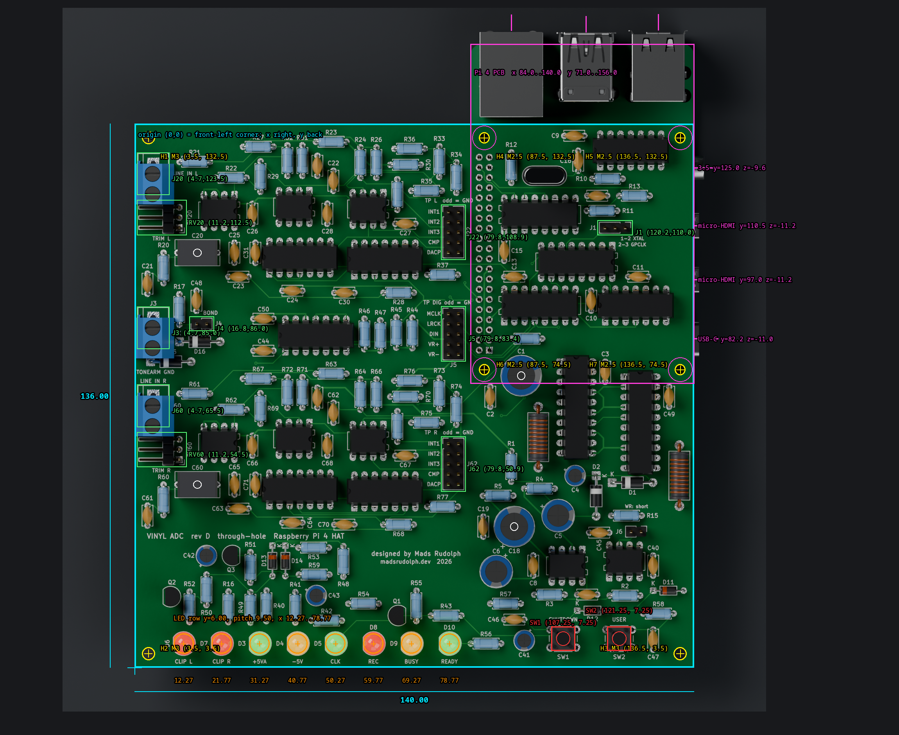
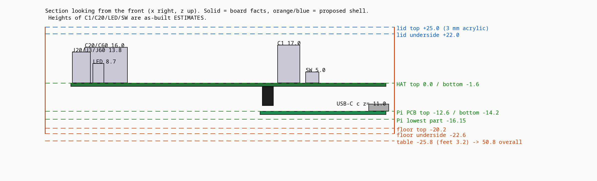

# Rev D enclosure: mechanical spec

This is the input for the CAD stage. It covers the Vinyl ADC rev D HAT (140 × 136 mm, 4-layer, all through-hole) with a Raspberry Pi 4B plugged in underneath. Every number below comes from [`board_mech.json`](board_mech.json), which [`extract_board_mech.py`](extract_board_mech.py) generates from `hardware/kicad/rev_d/vinyl_adc_rev_d.kicad_pcb`, the KiCad GLB export and the Pi 4B model. If the JSON and this page disagree, the JSON is right; rerun the script after any board change.

- **Exact:** the outline, holes, pads, LED and switch positions and the connector positions all come straight from the PCB file.
- **Model-based (good to about ±0.3 mm):** the Pi geometry. It uses the Pi 4B STEP model placed as in `render_rev_d.py`. Its four holes land on the HAT's M2.5 holes to within 0.02 mm.
- **Estimated (must be measured before printing):** the as-built part heights. Several fitted parts differ from the KiCad models: the LEDs sit flush, the film capacitors are large MKT boxes, the electrolytics are tall and the ICs are socketed. See §7.

## 1. Coordinate frame

| | |
|---|---|
| Origin | Board **front-left corner**. Front is the LED edge. |
| +x | Right, toward the edge where the Pi's USB-C, HDMI and audio ports exit |
| +y | Back, toward the Pi's USB and Ethernet end |
| +z | Up. **z = 0 is the top (component) face of the HAT.** The HAT bottom face is z = −1.6. |
| From KiCad page coordinates | x = X − 51.06, y = 157.5 − Y |

*`top_overlay.png`: the extracted coordinates drawn over the orthographic top render (`media/showcase/rev-d/top.png`, 10.227 px/mm, camera at board (70, 77)). Cyan is the board outline. Yellow marks the HAT holes, magenta the Pi PCB, its holes and its right-edge ports, orange the LED optical centres, red the switches and green the connectors you need to reach. Every marker lands on its rendered part, which verifies the frame, the pad-centroid maths and the Pi placement.*

*`stack_section.png`: the z stack seen from the front. The proposed shell levels from §4 are dashed.*

## 2. Board and holes

The outline is a 140.00 × 136.00 mm rectangle with **square corners** and no radius. The board is 1.6 mm thick. Copper pour is on F.Cu only.

All seven holes are **NPTH (unplated, no annular ring)**. Screw heads and washers bear on soldermask, so use nylon washers. "Copper clearance" in the table is the radius to the nearest pad or track edge. Keep any post, head or washer inside it, with 0.3 mm margin.

| Ref | x | y | Drill | Thread | Role | Copper clearance (pads / tracks) | Max head/washer Ø |
|---|---|---|---|---|---|---|---|
| H2 | 3.50 | 3.50 | 3.2 | M3 | HAT → enclosure, front-left | 7.0 / 10.2 | 13.4 |
| H3 | 136.50 | 3.50 | 3.2 | M3 | HAT → enclosure, front-right | 6.0 / 8.1 | 11.4 |
| H1 | 3.50 | 132.50 | 3.2 | M3 | HAT → enclosure, back-left | 5.1 / 6.5 | 9.6 |
| H6 | 87.50 | 74.50 | 2.7 | M2.5 | Pi stack | 4.2 / 7.2 | 7.8 |
| H7 | 136.50 | 74.50 | 2.7 | M2.5 | Pi stack | 4.3 / 4.5 | 7.9 |
| H4 | 87.50 | 132.50 | 2.7 | M2.5 | Pi stack | 4.2 / 7.2 | 7.8 |
| H5 | 136.50 | 132.50 | 2.7 | M2.5 | Pi stack | 3.6 / 14.1 | 6.6 |

The back-right corner has **no M3 hole**. The Pi's M2.5 hole H5 sits there instead, so the HAT is held to the enclosure by three M3 posts plus the four Pi-stack columns. The M2.5 holes are on the Pi 4's 49 × 58 mm pattern. The HAT and the Pi share those four axes.

## 3. Raspberry Pi 4 under the HAT

| Item | Value |
|---|---|
| Pi PCB | x 84.0–140.0, y 71.0–156.0, z −14.2 to −12.6. Size 56 × 85 mm, corner radius 3. The short axis runs along x, flush with the HAT's right edge. **It overhangs the HAT's back edge by 20 mm.** |
| HAT ↔ Pi | 11 mm M2.5 female-female standoffs: 8.5 mm socket (J2) + 2.5 mm header body. J2 occupies x 85.0–90.0, y 78.1–128.9, z −10.2 to −1.7 (pin 1 at (88.77, 79.37)). |
| Lowest Pi part | z −16.15 (underside test pads and the microSD socket) |
| PoE header tips | x 92.1–95.2, y 131.1–134.1, z −2.6. That is only 1.0 mm below the HAT copper side, so nothing else fits there. |
| SoC (BCM2711, the heat source) | x 100.1–114.7, y 92.9–107.5, top z −10.3. It sits under the HAT. There is room for a 15 × 15 × ≤ 5 mm stick-on heatsink: 6.2 mm to the HAT's lead tips. |
| microSD | Card tip at y ≈ 66.5, x 106.5–117.5, z −15.4 to −14.6, on the Pi underside under the middle of the HAT. It cannot be reached from outside. An optional floor slot (§6) allows fingernail or tweezer removal. |

### Ports

| Port | Faces | Centre (x, y, z) | Receptacle (w × h) | Plug overmould to pass (w × h) |
|---|---|---|---|---|
| USB-C power | right | (141.2, 82.2, −11.0) | 9.0 × 3.2 | 12.5 × 7.0 |
| micro-HDMI 0 | right | (141.2, 97.0, −11.2) | 6.5 × 2.9 | 11.5 × 7.5 |
| micro-HDMI 1 | right | (141.2, 110.5, −11.2) | 6.5 × 2.9 | 11.5 × 7.5 |
| 3.5 mm audio | right | (142.5, 125.0, −9.6) | 6.0 × 6.0 | 8 × 8 |
| Gigabit Ethernet | back | (94.3, 159.25, −5.8) | x 86.2–102.4, z −12.6 to +1.05 | RJ45 boot ≈ 14 × 16 |
| USB 3.0 pair (blue) | back | (113.0, 158.85, −4.4) | x 105.5–120.5, z −12.6 to +3.74 | ≈ 16 × 9 per plug |
| USB 2.0 pair | back | (131.0, 159.36, −4.8) | x 123.6–138.5, z −12.6 to +3.0 | ≈ 16 × 9 per plug |

- **Port faces:** the right-side receptacle faces sit at x = 141.2 (audio at 142.5), and the back faces at y ≈ 159.3. Size every wall cut-out for the **plug overmould**, so the plug seats fully. The wall must not stand between the overmould and the receptacle face.
- **USB/Ethernet height:** the jacks rise to **z +3.74, above the HAT's top face**. They sit behind the HAT (jack bodies start at y 137.6) and are covered by the lid.
- **Power:** USB-C power is mid-way along the right side. To get the power lead to the back, use the optional right-angle USB-C extension (BOM).

## 4. Proposed shell envelope (CAD may refine; the reasoning is given)

| Level / face | Value | Why |
|---|---|---|
| Lid top | z +25.0 | 3 mm acrylic |
| Lid underside | **z +22.0** | Tallest as-built part is estimated at 17 mm, and the design envelope is 20 mm; this leaves ≥ 2 mm. Lower it only after §7 measurements. |
| HAT top / bottom | 0.0 / −1.6 | |
| Pi bottom | −14.2 | Pi bosses rise to here: 6.0 mm tall, Ø ≤ 6.0 (the Pi pad is 6 mm) |
| Floor top | −20.2 | 4.05 mm air under the Pi's lowest part, for vent airflow |
| Floor underside | −22.6 | 2.4 mm floor |
| Table (feet 3.2 mm) | −25.8 | **Overall height 50.8 mm (2.00″).** This matches the Fosi ZA3 and Schiit Saga S height line (AESTHETIC.md). |
| Left wall inner face | x −8.4 | 8 mm gutter for the terminal-block wires. The blocks are at the left edge and their wire entry faces −x. |
| Right wall inner face | x 140.6 | 0.6 mm from the board edge. The ports protrude to 141.2/142.5 into the cut-outs. |
| Front inner face | y −0.4 | The front bezel (§6) sits over the LED/switch strip |
| Back wall inner face | y 159.6 | Port faces at 159.25–159.36 |
| Outer size (3.0 mm side/back walls, 5.0 mm front bezel) | **155.0 W × 168.0 D × 50.8 H** (x −11.4…143.6, y −5.4…162.6) | 155 mm also matches the ZA3's 154.9 mm |

**M3 HAT posts:** they run from the floor top to the HAT bottom, which makes them **18.6 mm tall**. Make them Ø 8.0 at H2/H3 and Ø ≤ 9.0 at H1. Put an M3 heat-set insert at the top and fix the HAT with an M3×6 button head and a nylon washer.

**Pi columns (top to bottom):**
1. M2.5×5 screw through the HAT, into the 11 mm F-F standoff.
2. The standoff, from z −1.6 to −12.6.
3. The Pi PCB.
4. A 6.0 mm floor boss.
5. An M2.5×10 screw from under the floor (counterbored 3 mm deep, Ø 5.5). It passes through the boss and the Pi into the standoff, with 3 mm of thread engagement.

The whole stack is then one rigid unit. Before the HAT goes on, the Pi alone can be screwed to the floor.

## 5. Front strip: LEDs and buttons

### LEDs

| | D6 | D7 | D3 | D4 | D5 | D8 | D9 | D10 |
|---|---|---|---|---|---|---|---|---|
| Label (silk) | CLIP L | CLIP R | +5VA | −5V | CLK | REC | BUSY | READY |
| Colour | red | red | green | yellow | green | red | yellow | green |
| x (optical centre) | 12.27 | 21.77 | 31.27 | 40.77 | 50.27 | 59.77 | 69.27 | 78.77 |

- **Row position:** y = 6.00 for all eight, on an exact **9.50 mm** pitch.
- **Centre point:** the optical centre is the midpoint of the two pads. It is *not* the KiCad anchor, which is pad 1 and sits 1.27 mm to −x.
- **Body:** 5 mm diffused LED, flange Ø 5.8 with a flat on the cathode (−x) side. The board is 2.75 mm in front of the LED body.
- **Height:** top of dome at **z ≈ 8.7 (estimate)**. The photos show the LEDs seated flush. The KiCad model has a 3 mm standoff (top 11.6), so design the diffuser fit to handle **8.6–11.6** (sprung or slip-fit; see AESTHETIC.md) until Mads measures.
- **Brightness:** Mads says they are too bright. Diffusers should cut the light by roughly 3–5×. The CLIP LEDs are always on until the U12 rework, so there will be a lot of red light; give each cell an opaque wall so they don't bleed into each other.

### Switches

| | SW1 | SW2 |
|---|---|---|
| Function | SHUTDOWN / WAKE (GPIO3) | USER (GPIO23) |
| Centre (pad centroid) | (107.25, 7.25) | (121.25, 7.25) |

- **Body:** 6 × 6 mm THT tact switch, 3.5 mm body with a Ø 3.5 plunger.
- **Plunger top:** model z 4.3, estimate **5.0**, possible range 4.3–9.5 depending on the variant. MEASURE.
- **Action:** travel 0.25 mm, 160–260 gf.
- **Button design:** printed buttons press straight down (−z) on the plunger. The stem stops 0.3 mm above the plunger. Bezel or lid features take the overtravel, never the switch.

Nothing else sits near the strip: the nearest parts are R56, C41, C46, C47, C40 and D12 (see the JSON). The LED dome fronts are 3.5 mm from the board's front edge.

## 6. Access, openings and keep-outs

| Item | Location | Need |
|---|---|---|
| J20 LINE IN L / J3 TONEARM GND / J60 LINE IN R | Left edge. Pad centroids (4.7, 123.5), (4.7, 85.0), (4.7, 65.5). Courtyards x 0.66–8.7. | Screws on top, wires from −x. They are set at install time, with the lid off. Route the wires through the left gutter to the rear-panel RCA jacks and ground post (recommended), or through a grommet slot in the left wall. |
| RV20 / RV60 trimmers | (11.2, 112.5) / (11.2, 54.5) | Rare. Screwdriver from the top with the lid off. Body type unknown (see §7). |
| J1 CLK SEL (1-2 XTAL, 2-3 GPCLK), J4 GND BOND, J6 WP | (120.2, 110.0), (16.8, 86.0), (125.5, 34.0) | Rare. Lid off. |
| J22 / J5 / J62 test headers, 2×5, odd pins = GND | (79.8, 108.9), (79.8, 83.4), (79.8, 50.9). Pins 8.5 mm tall. | Bench probing (Mads probes on header pins), so the **lid must come off quickly**: 4 screws or magnets, no glue, no hidden clips. |
| Pi ports | §3 | Right wall: USB-C, 2× micro-HDMI, audio. Back wall: Ethernet and 4× USB. |
| microSD | Card tip (112, 66.5, −15) | Optional floor slot x 104–120, y 60–71 |
| Ventilation | Floor under the SoC (x 98–117, y 90–110) and under the Pi generally; the back wall around the ports | Slots ≥ 2 mm wide with 2 mm ribs. Pi 4 dissipates 3–6 W under a hat that covers it. |

Keep-out volumes, as boxes in `board_mech.json → keepouts`:

- HAT top-side envelope: z 0–20 (design value) over the whole board.
- HAT underside lead tips: z −4.1 to −1.6 where there is no Pi. Only the M3 posts may touch the underside. The U12 rework wires are on that side.
- The Pi with all its ports: x 84.0–142.5, y 66.5–159.4, z −16.15 to +3.74.
- The terminal-block wire gutter: x −8 to 0, y 60–132.
- Probe clearance over J5/J22/J62.

## 7. Measure before printing (estimates in the JSON are flagged `as_built`)

1. **LED dome top** z, all 8 LEDs (estimate 8.7; model 11.6).
2. **SW1/SW2 plunger top** z (estimate 5.0; range 4.3–9.5).
3. **C1 and C18 (470 µF) heights** (estimate 17), and **C5/C6 (220 µF)** (estimate 13).
4. **C20/C60 envelopes.** These are Philips MKT 373 1.5 µF boxes, estimated at 16 mm tall, occupying x 6.5–25.5 around y 103.75 and y 45.75. Check whether they lean over RV20/RV60.
5. **RV20/RV60 trimmer bodies** and where their adjustment screws point.
6. **Socketed DIP height** (estimate model + 4.5 ≈ 8.2).
7. **Terminal-block overhang** past the left edge, and their height (model 13.8; fitted green blocks look about 10–11).
8. **Actual HAT ↔ Pi standoff length**, i.e. the measured gap between the HAT bottom and the Pi top (spec 11.0).
9. **Tallest thing on the board overall**, with a straightedge laid across it. If it is under 17, lower the lid (§4) and shrink the overall height. Keep the 50.8 overall line by adding the difference to the feet or plinth.

## 8. Print constraints (Prusa MK4: 250 × 210 × 220 mm, 0.4 mm nozzle)

Mads's PrusaSlicer favourites are the MK4 and the XL, and his Connect upload log shows MK4 + PLA + 0.4 mm.

- **Fit:** the shell (155 × 168 × 47.6 without lid) fits the MK4 bed in one piece, floor-down, with no rotation needed.
- **Material:** the Pi's SoC runs at 50–70 °C and the air inside will reach about 40–45 °C. Prefer **PETG** (or ASA) for the shell and the posts that carry the Pi. PLA is fine for the bezel, buttons and diffuser parts.
- **Walls and supports:** walls ≥ 2.0 mm (3.0 nominal). Self-supporting overhangs ≤ 45°; bridges ≤ 10 mm. Port cut-outs with flat tops wider than 10 mm need a 45° "teardrop" or arched top, or sacrificial bridging layers.
- **Heat-set inserts:** use the pilot from the existing coupon `enclosure/m3_insert_fit_coupon.stl` (4.2 mm × 6.5 deep for ~4.6 OD × 5.7 inserts). Print it in the final material first. Bosses ≥ 2× insert OD, i.e. ≥ 9 mm.
- **Clearances:** 0.2 mm per side for sliding fits (buttons in bores), 0.1 mm for press fits, 0.4 mm around the board edge and connector cut-outs.
- **Holes:** horizontal holes come out ~0.2 mm undersize; vertical bores come out round.
- **Surfaces:** print cosmetic faces flat on the sheet (textured PEI gives the sandblasted finish described in AESTHETIC.md), or vertical with the seam at the back. No visible support scars on outside faces.
- **Acrylic lid:** 3.0 mm cast acrylic. Laser kerf ≈ 0.15–0.2 mm; compensate for it in the DXF. Holes for M3 screws are Ø 3.4; button bores (if any) are stem Ø + 0.4.
